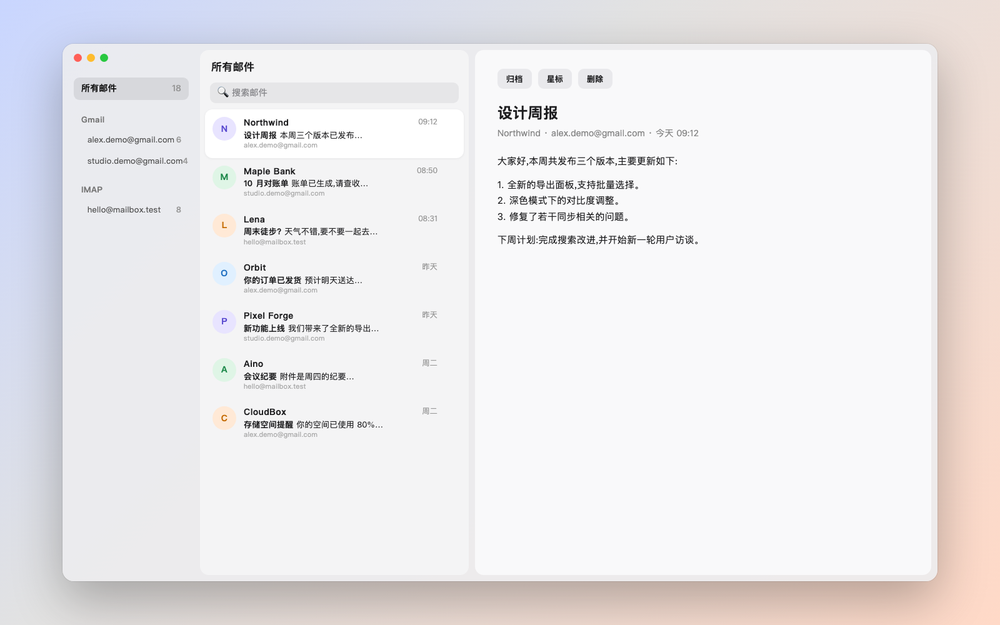
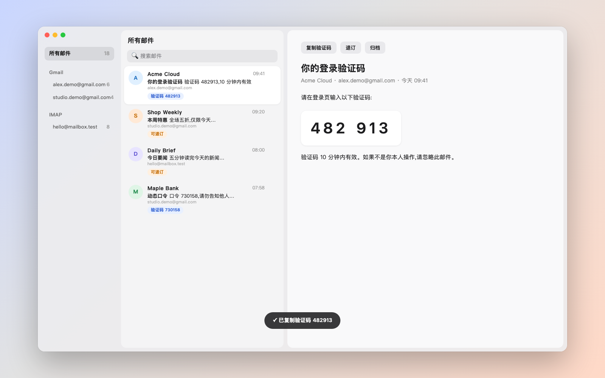
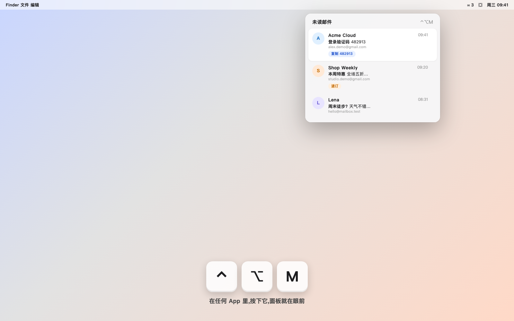

<p align="center"></p>

<h1 align="center">pigi</h1>
<p align="center">多个邮箱,一个窗口,一个快捷键。<br>开源的 macOS 原生邮件客户端 · Gmail API + IMAP · 无服务器</p>

<p align="center"><a href="https://pigi.xiezhaoye.site/">官网与下载</a> · <a href="docs/gmail-api.md">Gmail 接入教程</a> · <a href="docs/architecture.md">架构</a></p>



## 特点

- **多账号管理**:Gmail 与 IMAP 邮箱同时添加,汇成一条时间线,也可按账号查看。
- **退订与验证码**:识别 List-Unsubscribe(含 RFC 8058 一键退订),一键退订并归档;自动提取验证码,点一下复制。
- **高效操作**:全局快捷键(默认 ⌃⌥M)唤起菜单栏面板;J / K / E / S / ⌫ 处理邮件;快捷键可自定义。
- **本地优先**:邮件存在本机 SQLite(FTS5 全文搜索),令牌和密码存在钥匙串,没有中转服务器。





以上为示意界面，邮件均为虚构数据。

## 安装

从[官网](https://pigi.xiezhaoye.site/)下载 zip,拖进「应用程序」。安装包未经公证,首次打开请在「系统设置 → 隐私与安全性」点「仍要打开」。

要求:macOS 15+,Apple Silicon。

## 添加邮箱

- **IMAP**:设置 › 邮箱管理 › 添加邮箱 › 其他邮箱 (IMAP),填邮箱、应用专用密码、服务器与端口。
- **Gmail**:先按[教程](docs/gmail-api.md)申请自己的 OAuth 客户端 ID,粘贴到设置里,再添加 Gmail。(读写邮件属于 Google 受限权限,公开应用需付费安全评估,所以开源版使用你自己的客户端。)

## 从源码构建

```bash
brew install xcodegen
xcodegen generate
xcodebuild -project Pigi.xcodeproj -scheme Pigi -configuration Debug -derivedDataPath build build
open build/Build/Products/Debug/pigi.app
```

自己构建时,请在 `project.yml` 里把 `PRODUCT_BUNDLE_IDENTIFIER` 改成你自己的,Gmail 的 OAuth 客户端 Bundle ID 也要与之一致。

## 常见问题

**我的邮件会经过 pigi 的服务器吗？**  
不会。pigi 没有服务器，应用直接连接 Google 或你填写的 IMAP 服务器，邮件和凭据只保存在你的 Mac 上。

**为什么 Gmail 要自己申请 OAuth 客户端？**  
读写邮件属于 Google 的受限权限，公开发布需要付费的第三方安全评估。开源版让你使用自己的客户端，数据完全由你掌控。步骤见[教程](docs/gmail-api.md)。

**需要什么权限？**  
网络访问、通知（可关闭）。钥匙串用于保存令牌和 IMAP 密码，不需要辅助功能权限。

## 已知限制

- 只读整理,暂不支持发信。
- IMAP 每分钟轮询,暂未使用 IDLE。
- 未经公证。

## 许可

[MIT](LICENSE)
